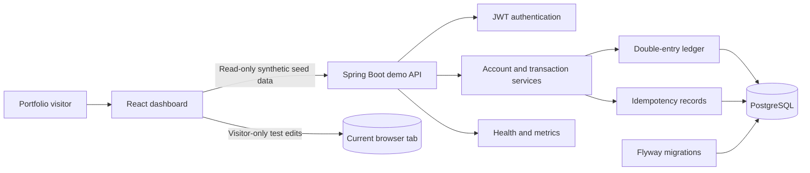
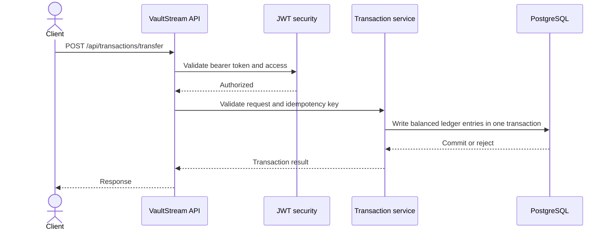

<div align="center">

# VaultStream

### A ledger and payments API engineering portfolio project

[](https://github.com/Priyadharsan-85/VaultStream/actions/workflows/ci.yml)


**VaultStream is a Java backend portfolio project with a React dashboard for exploring ledger integrity, API security, and operational safeguards.**

[Explore the design](#architecture) · [Run locally](#run-locally) · [Try the API](#api-overview) · [Deploy a demo](RENDER_DEMO.md) · [Production status](PRODUCTION_READINESS.md)

</div>

---

> [!CAUTION]
> **Educational demo only. VaultStream is not a bank, wallet, payment processor, or production-ready financial service. Never connect real customer funds or personal data.** The public dashboard's add, edit, and remove controls change fictional records in the visitor's browser tab only; the hosted API remains read-only, and customer transfers and registration stay disabled.

## Project at a glance

| | |
|---|---|
| **What it demonstrates** | Double-entry ledger patterns, transactional APIs, JWT authentication, idempotency, reconciliation, and monitoring |
| **Application type** | React portfolio dashboard with a private, tab-local test sandbox plus a read-only Spring Boot demo API |
| **Demo data** | Use synthetic accounts and transactions only |
| **Stack** | Java 17 · Spring Boot · React · TypeScript · Vite · Tailwind CSS · PostgreSQL · Docker |
| **Quality checks** | Maven verification, container build and image scan, CodeQL, dependency review |

## Architecture



### A transfer request



## Capabilities

- Double-entry journal entries with reconciliation checks
- JWT authentication, role-based administration, and logout token revocation
- Request idempotency and duplicate reference protection
- Account statements and paginated transaction history
- Login throttling, transfer limits, and velocity checks
- Flyway migrations, health endpoints, metrics, and containerized local services
- Production safeguards that disable risky ledger operations by default

These are software demonstrations, not evidence of financial compliance, high-volume capacity, or suitability for real funds.

## Run locally

### With Docker Compose

```bash
docker compose up --build
```

| Service | Local address | Purpose |
|---|---|---|
| API | `http://localhost:8082` | REST API |
| Swagger UI | `http://localhost:8082/swagger-ui/index.html` | Explore the development API |
| OpenAPI JSON | `http://localhost:8082/v3/api-docs` | API schema |
| Prometheus | `http://localhost:9090` | Local metrics collection |
| Grafana | `http://localhost:3000` | Local dashboards |

Local Compose credentials and sample settings are for development only. Never reuse them in a public deployment. Stop the services with `docker compose down`.

### Without Docker

Install JDK 17, Maven, and PostgreSQL, set the database and JWT environment values, then run:

```bash
mvn spring-boot:run
```

### Run the React dashboard

Install Node.js 24 LTS, then start the dashboard from the frontend folder:

```bash
cd frontend
npm ci
npm run dev
```

Open `http://localhost:5173`. Vite proxies `/api` requests to `http://localhost:8080`. To populate the dashboard locally, run the backend with its Render demo profile and a separate synthetic-data database. The hosted Render setup builds the dashboard as a static site and allows it to call only the public demo API.

## API overview

Authentication is available at `/api/auth/login`. Account and transaction routes require a bearer token. Administrative routes require an administrator token.

| Area | Example routes |
|---|---|
| Public demo | `GET /api/demo/overview` (read-only synthetic snapshot), `GET /api/demo/live` (simulated server-sent event stream; Render demo profile only) |
| Authentication | `POST /api/auth/login`, `POST /api/auth/register`, `POST /api/auth/logout` |
| Accounts | `GET /api/accounts`, `GET /api/accounts/{id}`, `GET /api/accounts/{id}/statement`, `POST /api/accounts` |
| Transactions | `GET /api/transactions/account/{accountId}`, `POST /api/transactions/transfer` |
| Administration | `GET /api/admin/ledger/reconcile/latest`, `POST /api/admin/ledger/reconcile`, account management routes |
| Health | `GET /actuator/health`, `GET /actuator/health/liveness` |

Visitors can explore two synthetic accounts and 30 days of sample history without logging in. A separate `/api/demo/live` stream emits generated events every six seconds; the dashboard applies these only to its in-memory view, updating the chart and balances without writing transactions to the database. Streams close after two minutes and reconnect automatically, with a cap on simultaneous connections. Visitors can also add, edit, and remove fictional ledger entries. Those personal test changes are held in that browser tab's `sessionStorage`, disappear when the tab closes, and are never sent to the API or shared with other visitors. The public overview endpoint remains fixed and read-only. Registration and real transfers are disabled in the hosted demo. API documentation is enabled for local development and disabled by the production profile. See the OpenAPI page when running locally for request and response schemas.

## Deploy a portfolio demo

The repository includes a Render Blueprint for a public React dashboard and demo API backed by a separate PostgreSQL database. It is intended for synthetic data only; the API may sleep while idle. Follow [RENDER_DEMO.md](RENDER_DEMO.md) for setup and verification steps.

Do not put database credentials or signing keys in GitHub, screenshots, or chat. The demo is not intended for personal data or customer funds.

## Production and customer funds

**VaultStream is not ready to accept customer funds.** A portfolio deployment is not a real-money launch. Before any financial use, the business model and jurisdiction need legal and regulatory review; required authorization and an eligible financial partner must be secured; and security, onboarding, settlement, reconciliation, support, and incident-response controls must be independently reviewed.

See [PRODUCTION_READINESS.md](PRODUCTION_READINESS.md) for the current status and open gates. The production Compose configuration is an engineering example, not a certification.

## Repository map

```text
src/main/java/       REST API, services, ledger, security, monitoring
src/main/resources/  Runtime profiles and Flyway migrations
src/test/            Automated tests
frontend/            React, TypeScript, Vite, and Tailwind dashboard
.github/workflows/   Build, test, and security checks
render.yaml          Render demo service blueprint
RENDER_DEMO.md       Demo database and hosting guide
PRODUCTION_READINESS.md  Financial production readiness status
```

## Contributing and verification

Build and run the automated checks with:

```bash
mvn verify
```

GitHub Actions also builds the Docker image and runs configured security checks. A passing build does not certify the project for real-world financial use.

## License

MIT. See [LICENSE](LICENSE).
