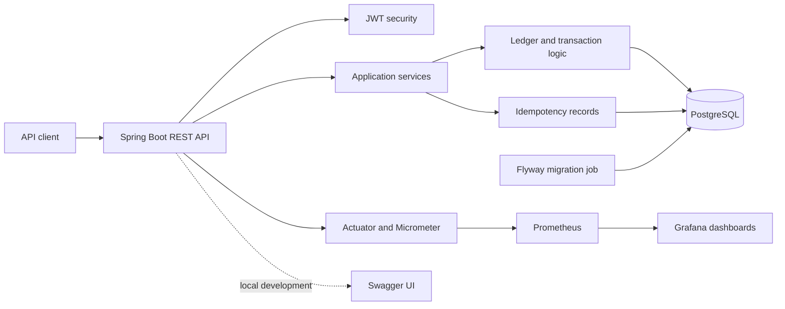
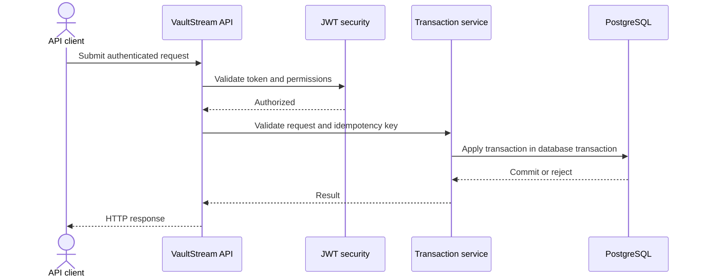

<div align="center">

# VaultStream

### A secure, observable ledger API for learning and development

[](https://github.com/Priyadharsan-85/VaultStream/actions/workflows/ci.yml)


**VaultStream is an educational backend project. It is not a bank or a payment product.**

[Quick start](#run-locally) · [Architecture](#architecture) · [API docs](#api-documentation) · [Production status](#production-and-customer-funds)

</div>

---

## At a glance

| | |
|---|---|
| **What it is** | A Spring Boot REST API demonstrating ledger, authentication, and operational patterns |
| **What it is not** | A regulated financial service, hosted wallet, or production-ready way to accept customer funds |
| **Frontend** | None currently; use the API and its local Swagger page during development |
| **Local stack** | Java 17 · Spring Boot · PostgreSQL · Docker Compose · Prometheus · Grafana |

> [!WARNING]
> **Demo and educational use only. Do not use VaultStream to hold, move, or represent real customer funds.** Production configuration disables customer transfers and manual balance adjustments. Real-money operation requires legal and regulatory review, an authorized financial partner, and substantial controls that this project does not provide.

## What VaultStream demonstrates

- A double-entry ledger model and transactional persistence
- JWT-based API authentication and role-aware access
- Idempotency support for retry-safe requests
- Database migrations and separate production database roles
- Health endpoints, metrics, dashboards, and containerized local development
- CI checks for builds and security analysis

These are learning and engineering examples; they are not a guarantee of zero discrepancies, high-volume capacity, or financial compliance.

## Architecture



### Example request lifecycle



## Does a frontend exist?

**No. This repository currently contains a backend only.** It has no React, Vue, Angular, or other customer-facing web application. Swagger UI is generated API documentation for developers; it is not a customer frontend. A separate frontend can be built later against the REST API, with its own authentication, accessibility, and security review.

## Run locally

Docker Compose is the quickest way to start the development stack. It binds service ports to `127.0.0.1`, so they are reachable from this computer only.

```bash
docker compose up --build
```

When the services report healthy, open:

| Service | Local address | Purpose |
|---|---|---|
| API | `http://localhost:8082` | Backend API |
| Swagger UI | `http://localhost:8082/swagger-ui/index.html` | Explore the development API |
| OpenAPI document | `http://localhost:8082/v3/api-docs` | Machine-readable API description |
| Prometheus | `http://localhost:9090` | Local metrics collection |
| Grafana | `http://localhost:3000` | Local dashboards |
| PostgreSQL | `localhost:5432` | Local development database |

The local Grafana credentials and database settings in Compose are **development-only**. Do not reuse them in a deployed environment. To stop the stack, run `docker compose down`; add `-v` only if you intentionally want to remove local database data.

### Run without Docker

You need JDK 17, Maven, and a PostgreSQL database configured for the application. Then run:

```bash
mvn spring-boot:run
```

The default application port when run directly is `8080` (Compose maps its API to host port `8082`). Configure secrets through environment variables; never commit real credentials.

## API documentation

The development Swagger UI is available at `http://localhost:8082/swagger-ui/index.html` after starting Compose. The OpenAPI JSON is at `http://localhost:8082/v3/api-docs`. Production configuration disables these documentation endpoints by default.

## Technology

| Area | Technology |
|---|---|
| Language and framework | Java 17, Spring Boot |
| API | Spring MVC, Springdoc OpenAPI |
| Persistence | Spring Data JPA, PostgreSQL, Flyway |
| Authentication | Spring Security, JWT |
| Monitoring | Actuator, Micrometer, Prometheus, Grafana |
| Build and runtime | Maven, Docker, Docker Compose |
| Code quality | MapStruct, Lombok |

## Repository map

```text
src/main/java/com/vaultstream/  Application code: API, services, models, security
src/main/resources/             Runtime configuration and database migrations
src/test/                       Automated tests
.github/workflows/              CI and security workflows
docker-compose.yml              Local development stack
docker-compose.prod.yml         Production-oriented container example
PRODUCTION_READINESS.md         Current launch decision and required gates
```

## Development checks

Run the Maven verification lifecycle before proposing code changes:

```bash
mvn verify
```

The GitHub Actions workflows also build the project and run configured security checks. A passing build does not certify the application for handling real money.

## Production and customer funds

VaultStream is **not ready to accept customer funds**. Production flags disable customer transfers, manual adjustments, and self-registration by default. Do not enable them for real customers or connect a real payment source until the business model has been legally classified, the necessary authorization and regulated partner are in place, and the operational, security, reconciliation, and incident-response controls have been independently reviewed.

For the current decision and a staged checklist, see [`PRODUCTION_READINESS.md`](PRODUCTION_READINESS.md). Treat the production Compose file as a deployment example, not proof of production readiness.

For a synthetic-data portfolio deployment only, see the [Render demo setup](RENDER_DEMO.md). It does not enable or support customer funds.


## Features

- **Double-entry accounting**: Every transaction affects at least two accounts to maintain balance
- **ACID-compliant transactions**: Ensures data integrity even under high concurrency
- **Idempotency keys**: Prevents duplicate charges from network retries
- **Real-time event processing**: Handles high-volume transaction streams efficiently
- **RESTful API**: Clean, well-documented endpoints for account and transaction management
- **JWT authentication**: Secure token-based authentication for API access
- **Docker support**: Easy containerization and deployment
- **Operational safeguards**: Health monitoring, hardened containers, backup tooling, and automated security checks
- **Spring Boot 3.x**: Modern Java framework with excellent performance
- **PostgreSQL**: Robust, scalable relational database
- **Micrometer metrics**: Built-in monitoring and observability
- **Swagger/OpenAPI**: Interactive API documentation

## Technology Stack

- **Language**: Java 17
- **Framework**: Spring Boot 3.5.16
- **Database**: PostgreSQL 15
- **Build Tool**: Maven
- **Containerization**: Docker & Docker Compose
- **Security**: JWT (JSON Web Tokens)
- **Validation**: Jakarta Validation
- **Monitoring**: Spring Boot Actuator, Micrometer
- **API Documentation**: Springdoc OpenAPI (Swagger UI)
- **Lombok**: Reduced boilerplate code
- **MapStruct**: Entity-DTO mapping

## Project Structure

```
vaultstream/
├── src/
│   ├── main/
│   │   ├── java/
│   │   │   └── com/vaultstream/
│   │   │       ├── controller/        # REST controllers
│   │   │       ├── dto/               # Data Transfer Objects
│   │   │       ├── exception/         # Custom exceptions
│   │   │       ├── idempotency/       # Idempotency handling
│   │   │       ├── mapper/            # MapStruct mappers
│   │   │       ├── model/             # JPA entities
│   │   │       ├── monitoring/        # Health checks & metrics
│   │   │       ├── repository/        # Spring Data repositories
│   │   │       ├── security/          # JWT authentication & authorization
│   │   │       └── service/           # Business logic services
│   │   └── resources/
│   │       ├── application.yml        # Configuration
│   │       └── init-db.sql            # Database initialization
├── Dockerfile                         # Docker build file
├── docker-compose.yml                 # Docker Compose configuration
├── pom.xml                            # Maven dependencies
└README.md                            # This file
```

## Getting Started

For the current launch decision and the remaining production gates, see the [production readiness checklist](PRODUCTION_READINESS.md).

### Prerequisites

- Java 17 JDK
- Maven 3.8+
- Docker & Docker Compose (for containerized deployment)
- PostgreSQL 15 (if not using Docker)

### Running Locally

1. Clone the repository
2. Configure your PostgreSQL database (update `application.yml` or set environment variables)
3. Build and run the application:

```bash
# Build the project
mvn clean package

# Run the application
mvn spring-boot:run
```

The application will start on `http://localhost:8080/api`

### Running locally with Docker

```bash
# Build and start all services
docker-compose up --build

# The application will be available at http://localhost:8080/api
```

### Production deployment

The production stack is separate from the local development stack. It runs the app with the `prod` profile, requires credentials and mounted secret files, persists PostgreSQL data in a named volume, and binds the app to localhost by default. Put a host-based HTTPS reverse proxy in front of it before exposing the service publicly.

Create secret files outside version control, then create a `.env` file. The bootstrap, migration, and runtime database roles must use different usernames and passwords:

```dotenv
DB_NAME=vaultstream
DB_BOOTSTRAP_USERNAME=vaultstream_bootstrap
DB_MIGRATION_USERNAME=vaultstream_migrator
DB_USERNAME=vaultstream_app
VAULTSTREAM_ADMIN_USERNAME=admin
VAULTSTREAM_ALLOWED_ORIGINS=https://app.example.com
VAULTSTREAM_REGISTRATION_ENABLED=false
DB_BOOTSTRAP_PASSWORD_FILE=./secrets/db_bootstrap_password
DB_MIGRATION_PASSWORD_FILE=./secrets/db_migration_password
DB_PASSWORD_FILE=./secrets/db_password
JWT_SECRET_FILE=./secrets/jwt_secret
VAULTSTREAM_ADMIN_PASSWORD_FILE=./secrets/admin_password
# Optional: change the local bind address/port when configuring a reverse proxy.
APP_BIND_ADDRESS=127.0.0.1
APP_PORT=8081
```

Create the files with unique values (the admin password must be 12-72 characters):

```bash
mkdir -p secrets
python3 -c "import secrets,sys; sys.stdout.write(secrets.token_urlsafe(48))" > secrets/db_password
python3 -c "import secrets,sys; sys.stdout.write(secrets.token_urlsafe(48))" > secrets/db_bootstrap_password
python3 -c "import secrets,sys; sys.stdout.write(secrets.token_urlsafe(48))" > secrets/db_migration_password
python3 -c "import secrets,sys; sys.stdout.write(secrets.token_urlsafe(64))" > secrets/jwt_secret
python3 -c "import secrets,sys; sys.stdout.write(secrets.token_urlsafe(32))" > secrets/admin_password
chmod 600 secrets/*
```

The PostgreSQL bootstrap role is a superuser used only by the database container during initialization. The long-running app uses a runtime role with data access to current and future tables and sequences. A separate one-shot container runs Flyway with a non-superuser migration role that owns the application database. The application container does not receive either the bootstrap or migration credential.

The initialization script creates these roles only when PostgreSQL initializes a new, empty data volume. Do not point this Compose setup at an existing database volume without first applying and reviewing an equivalent role/grant migration and confirming a recoverable backup. The production profile disables automatic Flyway runs in the API container; Compose starts the API only after the migration container exits successfully. Secret files are mounted read-only into the containers and loaded by Spring's config tree support. Keep `.env` and the `secrets/` directory out of source control and protect them on the deployment host. Then start the stack:

```bash
docker compose --env-file .env -f docker-compose.prod.yml up -d --build
```

The migration job and app start only after PostgreSQL reports healthy; the app waits for the migration job to complete successfully. PostgreSQL is not published to the host, and both application containers run as non-root users with read-only filesystems. Back up the PostgreSQL volume using a tested database backup and restore process before handling real data.

#### Database backups

Install the `age` encryption utility on the host and create an age key pair. Keep the private identity outside the application host and outside source control. Then create a consistent, encrypted custom-format database dump:

```bash
VAULTSTREAM_BACKUP_AGE_RECIPIENT=age1... bash scripts/backup-postgres.sh /path/to/secure/backup-storage
```

The script writes encrypted `.dump.age` files and removes incomplete output if the dump or encryption step fails. Configure your host scheduler to run it, copy completed files to access-controlled storage outside the application host, and enforce a retention policy there. The script does not schedule itself or upload backups. Before go-live, decrypt and restore a backup into a separate PostgreSQL instance and verify the application can read the restored data; record the restore result and recovery time.

### Environment Variables

| Variable | Description | Default |
|----------|-------------|---------|
| `DB_HOST` | Database host | `vaultstream-db` |
| `DB_PORT` | Database port | `5432` |
| `DB_NAME` | Database name | `vaultstream` |
| `DB_BOOTSTRAP_USERNAME` | PostgreSQL initialization superuser (database container only) | Required |
| `DB_MIGRATION_USERNAME` | Non-superuser role used by Flyway | Required |
| `DB_USERNAME` | Runtime application database role | Required |
| `DB_PASSWORD` | Database password | `vaultstream_pass` |
| `JWT_SECRET` | Secret key for JWT signing | Local-development fallback; set a secret in deployments |
| `VAULTSTREAM_ADMIN_USERNAME` | Optional username for the first administrator | - |
| `VAULTSTREAM_ADMIN_PASSWORD` | Optional administrator password (12-72 characters) | - |
| `VAULTSTREAM_LEDGER_MANUAL_ADJUSTMENTS_ENABLED` | Allow administrator-initiated manual deposits and withdrawals | `false` in production |
| `VAULTSTREAM_CUSTOMER_TRANSFERS_ENABLED` | Allow customer-initiated transfers between VaultStream accounts | `false` in production |
Production deployments must set all three database usernames, `DB_NAME`, `VAULTSTREAM_ADMIN_USERNAME`, `VAULTSTREAM_ALLOWED_ORIGINS`, and the five secret file paths shown above in the `.env` file. Set `VAULTSTREAM_ALLOWED_ORIGINS` to the exact HTTPS origin(s) of trusted browser clients, comma-separated when there are multiple. Self-registration and manual deposits/withdrawals are disabled by default in the production profile. Enable either only after the required verified onboarding or provider-backed settlement controls are in place. Account requests still require administrator approval. Do not use a wildcard or the local development defaults in a deployed environment.

## API Endpoints

### Authentication

- `POST /api/auth/login` - Authenticate user and receive JWT token
- `POST /api/auth/register` - Register with a username and password, then receive a JWT token (disabled by default in production)
- `POST /api/auth/logout` - Revoke the current bearer token

Set both administrator environment variables to provision the first admin user. Admins can approve or suspend accounts with `PUT /api/admin/accounts/{id}/status`.

### Accounts

- `GET /api/accounts/{id}` - Get account by ID
- `GET /api/accounts/number/{accountNumber}` - Get account by account number
- `GET /api/accounts` - Get a page of the authenticated user's accounts
- `POST /api/accounts` - Create new account
- `PUT /api/accounts/{id}` - Update account
- `DELETE /api/accounts/{id}` - Delete account
- `POST /api/accounts/{id}/deposit` - Admin-only manual deposit entry (disabled by default in production)
- `POST /api/accounts/{id}/withdraw` - Admin-only manual withdrawal entry (disabled by default in production)

Account and transaction history endpoints accept `page` (zero-based, default `0`) and `size` (default `20`, maximum `100`) query parameters. Results include page metadata such as `totalElements` and `totalPages`.

### Transactions

- `GET /api/transactions/{id}` - Get transaction by ID
- `GET /api/transactions/reference/{referenceId}` - Get transaction by reference ID
- `GET /api/transactions/account/{accountId}` - Get a page of transactions for an account
- `GET /api/transactions/account/{accountId}/range` - Get a page of transactions in a time range
- `POST /api/transactions/deposit` - Admin-only manual deposit transaction (disabled by default in production)
- `POST /api/transactions/withdraw` - Admin-only manual withdrawal transaction (disabled by default in production)
- `POST /api/transactions/transfer` - Create transfer transaction (disabled by default in production)

Example transaction history request: `GET /api/transactions/account/{accountId}?page=0&size=20`

### Monitoring & Health

- `GET /actuator/health` - Public application health status (details require an admin token)
- `GET /actuator/metrics` - Application metrics (admin token required)
- `GET /actuator/info` - Application information (admin token required)

The Prometheus scrape endpoint requires an administrator JWT. Configure the scraper to send `Authorization: Bearer <token>` and keep the endpoint behind a trusted network or reverse proxy when deploying publicly. The log-file endpoint also requires an administrator JWT.

## API Documentation

Once the application is running, you can access the interactive API documentation at:
- Swagger UI: `http://localhost:8080/api/swagger-ui.html`
- OpenAPI JSON: `http://localhost:8080/api/v3/api-docs`

These endpoints are for local/development use and are disabled in the production profile.

## Idempotency

VaultStream supports idempotency keys to prevent duplicate processing of requests. To use idempotency:

1. Include the `Idempotency-Key` header in your POST, PUT, or PATCH requests
2. The key should be unique for each request (UUID recommended)
3. The same key with the same method and path will return the cached response
4. Idempotency keys expire after 24 hours and expired records are cleaned up hourly

Example:
```http
POST /api/transactions/deposit
Idempotency-Key: 550e8400-e29b-41d4-a716-446655440000
Content-Type: application/json

{
  "accountId": "123e4567-e89b-12d3-a456-426614174000",
  "amount": "100.00",
  "referenceId": "dep_001",
  "description": "Initial deposit"
}
```

## Security

Login, API documentation, and basic health status are public. Registration is public only when enabled. Logout and other API endpoints require JWT authentication. Manual deposits and withdrawals and all actuator endpoints other than basic health require an administrator JWT; manual balance adjustments and customer transfers are disabled by default in production. These ledger operations do not establish regulated custody, payment processing, or settlement:

1. Obtain a token by calling `/api/auth/login` with username and password
2. Include the token in the Authorization header: `Bearer <token>`
3. Tokens expire after 1 hour (configurable)
4. Call `/api/auth/logout` with the bearer token to revoke it immediately

## Monitoring & Observability

VaultStream includes comprehensive monitoring capabilities:

- **Health Checks**: `/actuator/health` includes ledger-specific health indicators
- **Metrics**: Micrometer metrics for accounts and transactions
- **Logging**: Structured logging with SLF4J
- **Distributed Tracing**: Ready for integration with Zipkin/Jäger

## Testing

Run the test suite:

```bash
mvn test
```

## Building an image manually

Create a production Docker image:

```bash
docker build -t vaultstream:latest .
```

For production, use the production Compose stack above. The default Compose file is for local development:

```bash
docker-compose build
docker-compose up -d
```

## Configuration

The application can be configured through:
- `src/main/resources/application.yml` (default configuration)
- Environment variables (override YAML values)
- Command line arguments (override both)

## License

This project is licensed under the MIT License - see the LICENSE file for details.

## Acknowledgments

- Built with Spring Boot ecosystem
- Inspired by banking ledger best practices
- Designed for high-availability financial systems
